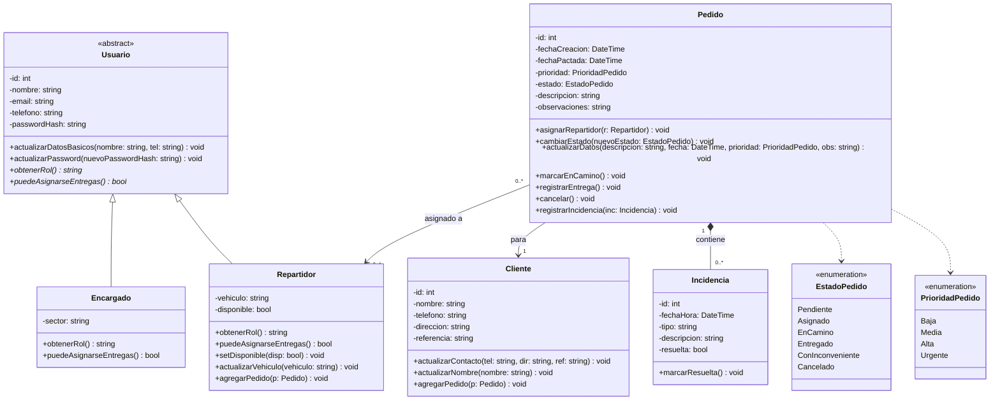
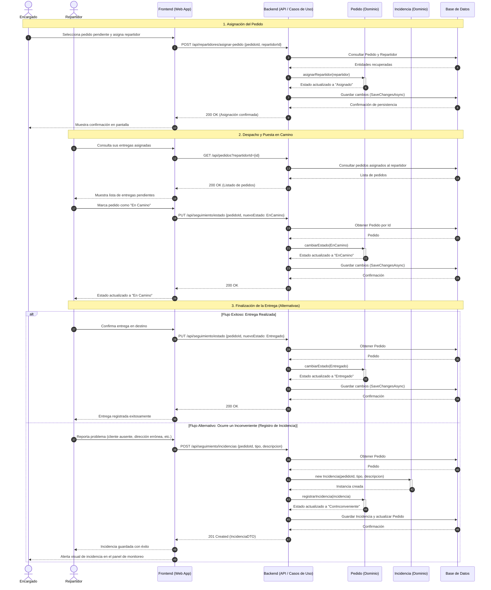

# Ruta Segura - UNAJ

Sistema web para la gestión, asignación y seguimiento de entregas en pequeños comercios y empresas que cuentan con logística propia.

---

## 📌 ¿Qué problema resuelve y quiénes lo usarían?

Pequeños comercios y empresas que realizan sus propias entregas suelen organizar los pedidos mediante WhatsApp, llamadas o anotaciones manuales. Cuando hay varias entregas en curso, resulta complejo saber con precisión qué pedido tiene asignado cada repartidor, cuáles ya fueron entregados y cuáles tuvieron inconvenientes.

### Usuarios del sistema:
* **Encargado / Coordinador de entregas**: Registra clientes y pedidos, asigna las entregas a los repartidores y monitorea los estados e incidencias.
* **Repartidores**: Consultan sus pedidos asignados, actualizan su disponibilidad y el estado de la entrega, y reportan inconvenientes ocurridos en la calle.

---

## 🎯 Alcance del MVP (Mínimo Producto Viable)

### ✅ Funcionalidades Incluidas:
* **Gestión de Clientes**: Registro y actualización de datos de contacto y direcciones con referencias.
* **Gestión de Pedidos**: Alta de pedidos con fecha de creación, fecha pactada, descripción y nivel de prioridad (`Baja`, `Media`, `Alta`, `Urgente`).
* **Asignación y Seguimiento**: Asignación de pedidos a repartidores disponibles y transición de estados (`Pendiente`, `Asignado`, `EnCamino`, `Entregado`, `ConInconveniente`).
* **Registro de Incidencias**: Carga de problemas ocurridos durante el reparto (cliente ausente, dirección errónea, rechazo del pedido, etc.).
* **Consultas y Filtros**: Visualización de pedidos organizados por su estado y ordenados por fecha o prioridad.
* **Control de Acceso**: Autenticación para usuarios autorizados con perfiles diferenciados (`Encargado` y `Repartidor`).

### ❌ Fuera del Alcance (Exclusiones explícitas para el MVP):
* Seguimiento GPS en tiempo real.
* Optimización automática de rutas.
* Integración con mapas interactivos (Google Maps / OpenStreetMap).
* Facturación electrónica y pasarelas de pago.
* Comunicación directa o automatizada con la API de WhatsApp.

---

## 🛠️ Metodología y Tecnologías

* **Metodología**: Scrum, con entregas semanales atadas al calendario de clases y seguimiento mediante tablero en Trello.
* **Lenguaje y Framework**: C# con ASP.NET Core (.NET 8).
* **Base de Datos**: Microsoft SQL Server (Docker).
* **Persistencia**: Entity Framework Core con SQL Server.
* **Diseño**: Aplicación web responsive (Vanilla HTML/CSS/JS).

---

## 🚀 Cómo levantar el proyecto y correr las pruebas

```bash
# 1. Levantar la base de datos (SQL Server en contenedor)
docker compose up -d

# 2. Levantar el backend (aplica migraciones y seed de usuarios automáticamente)
dotnet run --project backend/API

# 3. Correr todas las pruebas unitarias (44 pruebas)
dotnet test backend/RutaSegura.sln
```

> **Datos de acceso de prueba:**
> * **Encargado (Admin):** `admin@rutasegura.com` / `admin123`
> * **Repartidor:** `lucas@rutasegura.com` / `repartidor123`
> * **Frontend:** Abrir `frontend/index.html` directamente en el navegador (o con Live Server).
> * **Swagger API:** `http://localhost:5000/swagger` (o puerto asignado en consola).

## 📐 Diagrama de Clases UML



---

### Descripción del Diseño UML

1. **Herencia / Generalización (`Usuario <|-- Encargado`, `Usuario <|-- Repartidor`)**:
   `Usuario` es una clase abstracta que provee la lógica común de identidad y credenciales. `Encargado` y `Repartidor` heredan de ella y agregan sus atributos particulares (`sector`, `vehiculo`, disponibilidad), resolviendo polimórficamente la regla de negocio `puedeAsignarseEntregas()`.
2. **Separación de Responsabilidades**:
   La autenticación y orquestación de sesiones reside en la capa de Aplicación (`LoginUsuarioHandler` / `IPasswordHasher`), manteniendo la entidad `Usuario` pura sin acoplamiento a servicios técnicos.
3. **Composición (`Pedido "1" *-- "0..*" Incidencia`)**:
   Las incidencias tienen una relación todo-parte fuerte con el pedido; solo existen ligadas a un pedido determinado y no tienen sentido de forma huérfana.
4. **Asociación**:
   * `Pedido "0..*" --> "1" Cliente`: Todo pedido está asociado obligatoriamente a un único cliente.
   * `Pedido "0..*" --> "0..1" Repartidor`: Un pedido puede estar sin asignar (`0`) o asignado a un repartidor (`1`). A su vez, un repartidor puede tener varios pedidos a su cargo (`*`).
5. **Dependencia**:
   `Pedido` depende de las enumeraciones `EstadoPedido` y `PrioridadPedido` para tipificar de forma consistente su ciclo de vida y urgencia.

---

## 💻 Frontend Inicial: Vertical Slice (FRONT-01)

Interfaz de usuario ligera construida con HTML5, Modern Vanilla JS y CSS (Design System propio) sin dependencias externas pesadas, ubicada en `frontend/`:
- **Seguridad nativa:** Configuración mandatoria de peticiones HTTP con `credentials: 'include'` para intercambio automático de la cookie HttpOnly `RutaSegura.Session`.
- **Tablero de Seguimiento (RF12 / RF13):** Visualización de pedidos, KPIs dinámicos, filtros por estado, actualización de transiciones operativas y registro rápido de incidencias.
- **Historial y Trazabilidad (RF14):** Línea de tiempo cronológica (`OrderByDescending`), proyección de última incidencia (`FirstOrDefault`), y paneles visuales para los diccionarios clave-valor (`Dictionary<string, int>`) de conteo por tipo de incidencia y entregas por repartidor.

## 🔄 Diagrama de Secuencia UML

Representa la interacción entre los actores, las capas del sistema y las entidades del dominio para el flujo principal de **Gestión del Ciclo de Vida del Pedido (Asignación, Despacho y Resolución por Entrega o Incidencia)**.



### Descripción del Flujo de Secuencia

1. **Asignación del Pedido**:
   * El **Encargado** visualiza los pedidos pendientes y selecciona un repartidor disponible.
   * La API procesa la solicitud mediante el caso de uso `AsignarPedido`, invocando el método de dominio `asignarRepartidor(repartidor)` en la entidad `Pedido`. El estado transiciona de `Pendiente` a `Asignado`.
   * Los cambios se persisten en la base de datos a través del `UnitOfWork`.

2. **Puesta en Camino (Despacho)**:
   * El **Repartidor** consulta sus asignaciones desde su dispositivo y, al iniciar el reparto, marca el pedido como "En Camino".
   * El caso de uso `ActualizarEstadoEntrega` invoca `cambiarEstado(EnCamino)`, actualizando el ciclo de vida del pedido a `EnCamino`.

3. **Resolución de la Entrega (Bifurcación `alt`)**:
   * **Camino Feliz (Entrega Exitosa)**: El repartidor llega al destino y confirma la entrega. Se invoca `cambiarEstado(Entregado)`, culminando el proceso de forma exitosa.
   * **Flujo Alternativo (Incidencia)**: Si surge un inconveniente en la calle (domicilio inexistente, cliente ausente, rechazo), el repartidor registra el incidente mediante `RegistrarIncidencia`. Se crea la entidad `Incidencia`, se adjunta al pedido con `registrarIncidencia(incidencia)` y el estado del pedido pasa automáticamente a `ConInconveniente`. Esto dispara una alerta en el panel del encargado para su seguimiento o reprogramación.